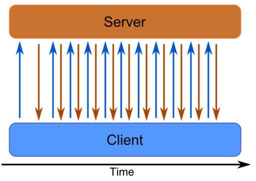
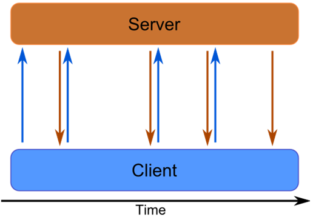
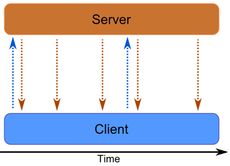
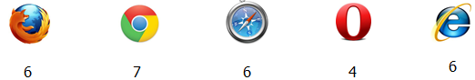

"Cometes" is a Latin word meaning "wearing long hair". Aristotle used it to describe stars with long hair: comets.

> Comet is a collection of HTTP-based techniques for handling long-lived connections.

Take a typical comet application: chat. You post messages and expect to see replies in real time as other users respond. You also want to know whether someone is typing and whether they are online or offline.

Comet handles the transfer in both directions, from client to server and from server to clients. In most cases, the client opens a single long-lived connection to the server. When an event occurs, the server sends back a message and closes the connection, and the client immediately opens a new one. This makes it possible to emulate client-to-client communication.

You can find comet in many popular web applications:

* Gmail uses it for notifications and chat.
* Facebook uses it for everything :).
* Google Docs uses it for its real-time multi-user editor.

## First attempts in 1996

Comet is not a new technology. Netscape introduced it in 1996, along with two new ideas:

* server push: the server sends messages to clients
* client pull: the client registers to receive messages

Example request:
```
GET http://www.w3.org/pub/WWW/TheProject.html HTTP/1.1
```

Response:
```
Content-type: multipart/x-mixed-replace;boundary=ThisRandomString

--ThisRandomString
Content-type: text/plain

Data for the first object.

--ThisRandomString
Content-type: text/plain

Data for the second and last object.

--ThisRandomString--
```

The client requests an image or an HTML page from the server. Each time the server pushes a response, the new value replaces the content of the DOM element. There can be delays between pushes.

Browser support is tragic: only Firefox supports it fully.

<figure>
  
  <figcaption>
    Comet browser support.
  </figcaption>
</figure>

### Why was Comet not globally adopted?
If comet was introduced in 1996, why did it not catch on everywhere? The answer is simple: there was no demand. Modern web applications of that time were plain HTML pages with a few images, connected by hyperlinks. The main use for comet was showing image advertisements, which is only a tiny fraction of its potential.

### Why is now a good time for real-time?
What has changed since 1996? First, web applications need to show more and more changes in real time: graphs, chat, browser notifications, client-to-client communication. Refreshing the whole page again and again would make them unusable. Second, browsers now widely support more comet methods, which makes comet much easier to implement.


## Transport: Polling
<figure>
  
  <figcaption>
    Polling as data transport.
  </figcaption>
</figure>

Polling is not a real comet technique, because it does not have the "long hair" :). It simulates real-time interaction by flooding the server with requests, and the server immediately answers each one with or without a message. The technique is simple, but you pay for that simplicity with several disadvantages:

* It does not scale. With more clients your server starts to lag, and it can become unusable even with very few of them (you DDoS your own server ;) ).
* It is inefficient. Every request carries HTTP overhead, and most of the time there is no message, so nothing but HTTP headers gets transferred. At a small scale this is negligible, but at a large scale you need to consider it.

## Transport: Long-Polling

<figure>
  
  <figcaption>
    Long polling as data transport.
  </figcaption>
</figure>
The difference between polling and long polling is the "long hair". Clients still pull for messages, but the server responds only when a message arrives or the connection times out. This is a more efficient way of doing comet. It is also the most widespread technique, because it works in every browser, even when fancier methods are available.

The problem is the number of clients. If your server holds a thread for every request until it responds, the number of clients is limited by the number of threads it can handle at once. This is the well-known [C10K problem](https://en.wikipedia.org/wiki/C10k_problem). Fortunately, Java recently overcame it with the [Servlet 3.0 JSR 315](https://jcp.org/aboutJava/communityprocess/final/jsr315/) specification. The request thread can now return to the pool and handle other requests while the socket stays open, waiting for an event. An event thread then writes the response.

## Transport: Streaming

<figure>
  
  <figcaption>
    Streaming as data transport.
  </figcaption>
</figure>

Streaming is similar to long polling, except that the server pushes several responses over the same connection, so it can be reused for more messages. You can do this by creating an XHR request and registering a handler.

```javascript
xmlhttp.onreadystatechange = function() {

  if ( xmlhttp.readyState == 3) { //data has arrived
    //process chunk
  }
}
```

The server responds with a data structure that can be deserialized. Since the data may arrive in chunks, the program has to demultiplex it and fire an event to the application once a whole message has been received.

* This does not work in IE :( because it returns only the whole message after the connection closes, not individual chunks. You can work around this, but it is trickier. One option is to bend IE by sending back JSONP: script tags with JavaScript that can run on the fly in an iframe. You can read more [here](https://meteorserver.org/browser-techniques/) and [here](http://cometdaily.com/2007/11/18/ie-activexhtmlfile-transport-part-ii/).


## Transport: HTML 5 API
The previous techniques were mostly hacks that bend browsers in ways they were never meant to be used. HTTP was designed as a one-way protocol, and now we need it to work both ways. These solutions run in all browsers, but they do not work as well as we would like. HTML 5 comes to the rescue with a JavaScript API that makes comet easier to implement.

### API: Event Sourcing
This is [standardized streaming](https://web.dev/articles/eventsource-basics). The client pulls, and the server pushes messages over the same connection.
```javascript
if (!!window.EventSource) {
  var source = new EventSource('stream.php');
} else {
  // Resort to xhr polling :(
}

source.onmessage = function (event) {
  alert(event.data);
};

source.addEventListener('add', function(e) {
  if ( e.readyState == EventSource.CLOSED ) {
    // Connection was closed.
  }
}, false);
```
The browser manages the connection and automatically reconnects when it closes.

### API: Websockets

<figure>
  
  <figcaption>
    Websockets as data transport.
  </figcaption>
</figure>

After 20 years of web evolution, we have finally realized that we need what C has had for a long time: sockets. There is no extra magic here. The client asks for an upgrade, the server parses the headers, and from then on both sides use the TCP connection directly. The connection is bidirectional, essentially a TCP socket for the web.

```javascript
var connection = new WebSocket('ws://go.to/stream');

connection.onopen = function () {
  connection.send('Ping'); // Send the message 'Ping' to the server
};

// Log errors
connection.onerror = function (error) {
  console.log('WebSocket Error ' + error);
};

// Log messages from the server
connection.onmessage = function (e) {
  console.log('Server: ' + e.data);
};
```


> RFC 2616: A single-user client should not maintain more than 2 connections with any server or proxy. 

Every browser limits how many parallel connections it can open. That is why comet is often implemented with a single connection to the server, with all messages multiplexed over it. If you go over the limit, a request simply waits until a connection is free, which can cause unwanted lag.

<figure>
  
  <figcaption>
    Number of parallel connections.
  </figcaption>
</figure>


#### Server side
In the Java world, Servlet 3.0 properly introduced comet, making it possible to implement without hacks through a standard API.
```java
@WebServlet(
  name="myServlet", 
  urlPatterns={"/slowprocess"},
  asyncSupported=true)
public class MyServlet extends HttpServlet {

    public void doGet(HttpServletRequest request, HttpServletResponse response) {
        //store context for later usage
        AsyncContext ctx = request.startAsync(); 
		...
        //you can register connection listener
        ctx.addListener(
        	new AsyncListener() {
            
              public void onComplete(AsyncEvent ae) {}
              public void onTimeout(AsyncEvent ae) {}
              public void onError(AsyncEvent ae) {}
              public void onStartAsync(AsyncEvent ae) {}
              
            }
        );
    }
}
```

The API is pretty simple. You mark the servlet as supporting long requests (asyncSupported=true), create an AsyncContext from the request and store it somewhere in memory. The doGet method does not block: it finishes normally, but the socket stays open. When an event occurs, you pick up the context and write the response as you would for a normal request.

### Web applications are evolving.
We have moved from simple HTML pages to single-page applications, and applications have become more social, more user-friendly and more useful. Comet is part of the paradigm shift taking web applications to a new level, even though HTTP was not designed for it. Many people have already realized this.

The web is no longer a static set of CSS and HTML. It has become an easy way to deliver apps written for a single platform. Whether you use Linux, Windows, Mac, Android or iOS, you can run the same apps, written once in JavaScript. Many have tried this before and failed: Java Applets, Adobe Flash, Microsoft Silverlight.

To be honest, web programming today is far from ideal, and making something work across browsers is a pain. Not all browsers fully support HTML 5 yet, but all of them are working towards it. That means less hacking and more focus on business value.
