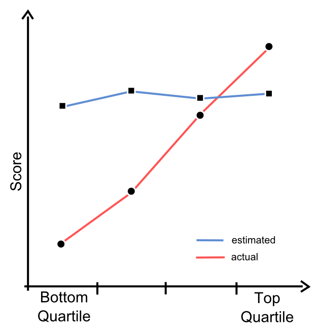

Programming is not only about code, design and architecture. A great deal of it is about the people we work with. I often find that I struggle more with ego than with reason, especially when dealing with senior developers who have "their ways".

One common problem is what I call the problem of the screwdriver. Say you need to mount a shelf with hex screws, but you do not own the right screwdriver. What do you do? Would you use the wrong one? Of course not. You would go to the shop and buy the right one. It is only logical.

In software, things often go differently. You face a group of programmers who cannot see why you need a different solution when the "wrong" screwdriver worked just fine yesterday. You try to explain, but your arguments are rejected for all sorts of odd reasons, like "I don't believe it will work better". Of course, new technology can bring [real problems](https://medium.com/netflix-techblog/node-js-in-flames-ddd073803aa4), and you have to mitigate those risks up front. But sometimes the problem lies neither in the technology nor in the business. It lies in people, or more precisely in their egos.

You quietly sigh and keep fighting, because you know how this would end otherwise: with a ruined screw, and any future change becoming nearly impossible.

If you care about your job, you will avoid this outcome, even if it makes you the black sheep. What motivates you is the product itself. You know that changing an amateurish design later would be drastic and costly, so you would probably never fully get rid of it. Making change hard is a guaranteed path to doom.

> The only constant in programming is change.

I have run into this kind of back-pressure many times with TDD. The peak of the resistance came when I refused to use an "in-house framework", someone else's toy that had been in development for years. Suddenly I was the bad colleague who had taken someone's toy away. At the time, this completely blew my mind.

I have seen the same thing wherever a framework, library or tool has been around for a while. People are unwilling to replace their favourite tools with ones that better fit the current situation.

> For several years I was the lone C programmer in that company. I thought that everybody should be programming in C. But I could not convince any of my brethren to start programming in C. Does anybody have that problem? With something like test driven development or agile practices? The most common questions that people would ask me when I do lecture on TDD, is how can I convince anybody else to do this. And the answer to this question is you can not. [Robert Martin](https://www.infoq.com/presentations/clojure-c)

For a long time I could not understand why such smart people make such bad decisions. The search for an answer took me far from programming, my area of expertise, and into psychology, specifically to the [Dunning-Kruger effect](https://en.wikipedia.org/wiki/Dunning%E2%80%93Kruger_effect).

The authors' research was inspired by the case of a bank robber named McArthur Wheeler:

> In 1995, McArthur Wheeler walked into two Pittsburgh banks and robbed them in broad daylight, with no visible attempt at disguise. He was arrested later that night, less than an hour after videotapes of him taken from surveillance cameras were broadcast on the 11 o'clock news. When police later showed him the tapes, Mr. Wheeler stared in incredulity. "But I wore the juice", he mumbled. Apparently, Mr. Wheeler was under the impression that rubbing one's face with lemon juice rendered it invisible to videotape cameras.

The experiment was carried out on undergraduate students at Cornell University. They were tested on topics such as humor, logical reasoning and English grammar, and then had to estimate how well they had done compared to the others. They knew nothing about the other students' results, so this was purely their own guess.

In their famous paper [Unskilled and unaware of it](./paper.pdf), they argued that:

> People are incompetent in the strategies they adopt to achieve success and satisfaction, they suffer a dual burden: Not only do they reach erroneous conclusions and make unfortunate choices, but their incompetence robs them of the ability to realize it.

<figure>
  
  <figcaption>
    Top performers underestimate themselves, under performers overestimate their competence.
  </figcaption>
</figure>

* Students with the lowest scores (bottom quartile) overestimated their results.
* Students with the highest scores (top quartile) underestimated their results.
* Top-quartile students improved their estimates after seeing the work of other participants.
* Bottom-quartile students struggled to recognize their incompetence, even after seeing the results of others.

> The competent do not know they are competent and the incompetent do not realize their incompetence.

Sometimes this is exactly the situation you are facing. You may work with highly skilled people who do not use their abilities fully because they underestimate themselves.

I have often heard that we are not big enough, that we cannot compete with giants like Google or Facebook. You can understand the feeling, but big teams do not work particularly well, and the great features you see these days are usually built by small teams just like yours. If you have skilled people, why not use their full potential, take the risk and head into uncharted waters? That is what lets you stretch your abilities beyond the competition.

> People tend to do what they are used to, and programmers are no exception.

You will also often meet colleagues with no motivation at all. They are smart and full of potential, but they do not believe in the project. This is an underrated problem.

As programmers, we like to focus on the technical side of a project and underestimate everything else, because it seems less important than the logical problems we love to solve. I used to think that algorithms were the hardest part of software development, but that stops being true once you work in a team.

Seemingly small things like motivation are essential for innovation. Motivation is the simple reason to bother learning something new, rather than sticking with what worked "just fine" yesterday.

> It is lethal when you use tools of yesterday today to invent something that will be successful tomorrow.

You have to focus on the idea itself, not on how to bend the wrong tools to fit it. That applies even to your favourite library, framework, programming language, operating system, database or cloud service.

I once saw a team move its file storage from OpenStack Swift to Mongo GridFS. They had found out that Swift constantly reads from disk to checksum stored files and guarantee consistency. Disks were failing more often than anyone expected. Hardware is expensive, and that is before counting the logistical delays of someone having to buy and install new disks. GridFS seems fine at first, with no constant checksumming, until software bugs start losing your data. Try explaining that to your customers :).

Then you realize that cloud providers like Amazon offer storage as a service for nothing more than a monthly fee. You also realize that storing large amounts of data is harder than it first seemed. It is not your core business either, and others already dominate it. From this point of view, migrating to Amazon looks very attractive. It still depends on your business: you will overpay if you store only a few GB, and storing half of the internet costs more than a custom solution.

So know your tools thoroughly, but keep exploring other options as well. Your problems may already be solved, and you may just be reinventing the wheel.
