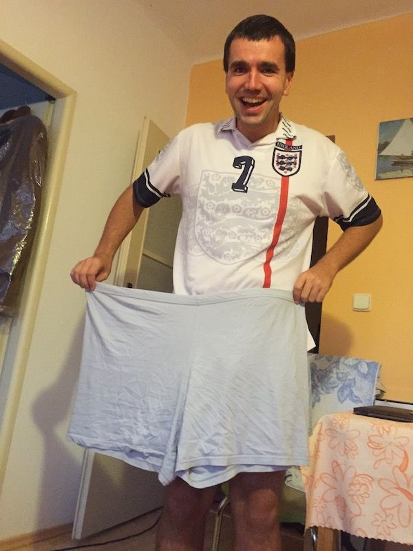
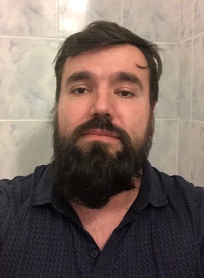
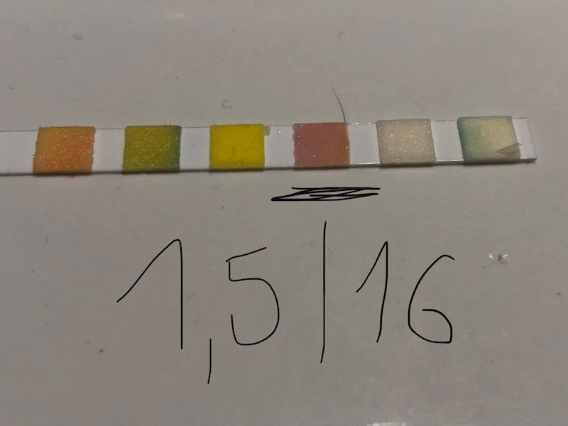
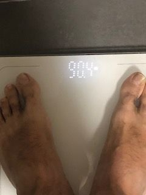
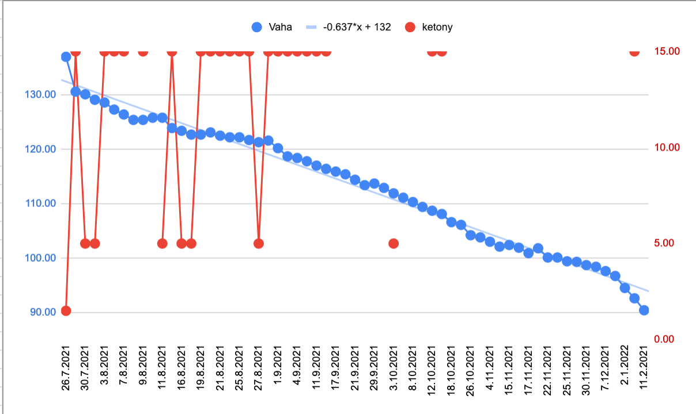
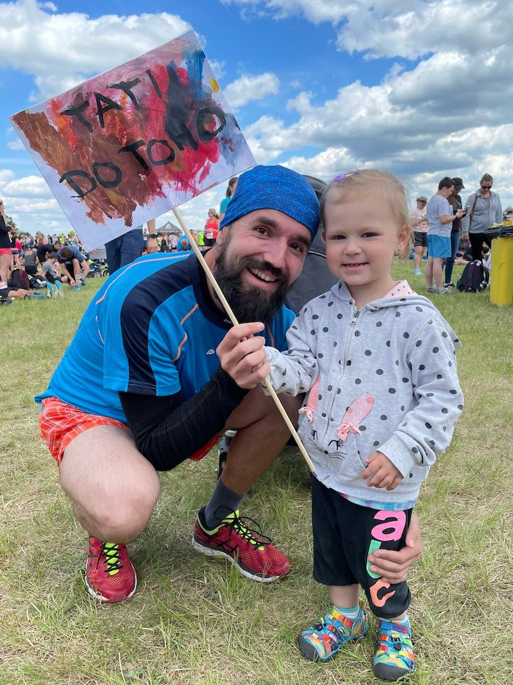

I was chubby all my life. A long time ago, I accepted it as part of my identity. I was unable to lose weight even when exercising and spending most of my free time outside chasing a ball. All my years at school I was overweight and unable to buy nice clothes as I was beyond off-the-rack sizes. But this is not a story about how hard it was then. You can imagine ... I was a target of bullies, xenophobia, finger-pointing and minimal support from family as my father wanted a slim, football-playing son that I could never be.  No, this is a story about how I got out of obesity, about pitfalls and how to finally lose 50kg of weight and manage to **stay** at the same weight for years. This story can be very beneficial for you if you want to lose weight or you know somebody in your family or friends who struggles with weight or you are just curious. Either way, my journey persuaded me that maintaining a stable weight is a topic for everybody. Obesity and type 2 diabetes are so prevalent that sooner or later your doctor will tell you that you need to lose weight as you are well on your way to dying of CVD - a heart attack. (If not, you will be one of the few, genetically lucky ones.)

The same happened to me years ago when I visited my general practitioner. I was an obese, single programmer spending too much time at work, sitting on a chair, drinking energy drinks, eating snacks, liters of coffee with milk. I was a workaholic. I spent nearly all my day at work coding or browsing the internet for how to do my job better. I was a true greenhorn, looking for the best design patterns and silver bullets. I always loved to be praised by my senior colleagues for great work. I was great material for burnout. And surely I did.

I came to a revelation one long night when I was working on a side project at home. At that time I managed to work all day at work, then at night walk back home and work the whole night through on a hobby project. I was eating my late second dinner after midnight. Thinking non-stop requires calories and sure enough I was binging a lot... One such evening I was sitting at the table and looked down at my belly. I could see just an obese body and I started wondering how I ended up here. I was always chubby but not obese. Somehow I decided at that moment that my problem with weight was an actual problem.

So I started with the gold standard "eat less and move more" strategy. I picked swimming for 1h. I was too obese to do anything else. I started swimming every second day. Determination was never my problem, fighting with bullies at school made me pretty resilient and strong minded. If I consider a problem a problem I always try my best. With such frequent exercise, one morning my trousers just fell off me and I spotted my first visible change.

With a couple of kilos down I could finally start doing other sports that I used to do. I started with running. I never liked sprints but I like endurance sports. I started slowly with 3km, 4km, and ended up with a regular 8km run after a few months. I also continued with swimming. It was actually very powerful combo and it started to be very, VERY visible.

<figure>
  
  <figcaption>
    My old pajama pants ended up as a floor rag.
  </figcaption>
</figure>

I ended up in the best physical form of my life. Actually regular sport decreased the number of night hacking shifts as my motivation changed and therefore my sleep improved a lot. I started to be very energetic. I lost my craving for sugar, for energy drinks and liters of coffee. It pumped my motivation and I started joining organized runs. I started to have a problem with clothes. I went from tight XXL to very comfortable L. I got the feeling that I was back ... finally.

If it ended here it would be only half of the story and it would look like clickbait. Life is more complicated than news headlines. I learned that the hard way ...

> Losing weight is easy, maintaining weight is the true art. 

My weight roller coaster started simply: I fell in love ❤...

There is nothing unusual about falling in love other than that your priorities will change. And exactly that happened to me. My spartan life ended. I started solving other more urgent matters. There was always something more important than simply getting outside for a run. I wanted to spend as much time with my wife as I could, doing casual things like watching films, having dinner together, visiting family members, feasts. We moved to a new location and started living together. In time we got two wonderful kids. My regular sporting habits lay in ruins. Though I did not stop completely. I went swimming in the local swimming pool and started running in nearby hills. But it was very rare compared to nearly daily sporting before and I was getting more chubby again. I thought and I still think it was a good compromise. We had newborn babies and it takes two adults to handle them. I needed to tandem this ride with my wife. That is what dads do.

The nail in the coffin was COVID-19 and lockdown. I stayed at my home office for many months and my weight was rock-climbing, again. My weight was once again over 130kg, my trick with swimming was not possible as everything was closed and I was too heavy for running. I tried to do yoga with my wife but I was so obese that I could not keep that habit. Yoga for the obese is actually hard.

Later I had to pick my old oversized clothes from an old box and put my lean shirts back into the box with a groan that one day I would take them back. I was depressed, I was feeling like a complete failure... I knew I needed to lose weight, change something but at that time I did not know where to start. As many obese people like me I was clueless. I had the determination to change, as I have been a fighter since childhood, but I felt so powerless.

<figure>
  
  <figcaption>
    Me, over 130kg.
  </figcaption>
</figure>

Then something totally unexpected happened ... I got lucky in my life.

The YouTube news feed algorithm showed me a video of the American doctor Dr. Pradip Jamnadas giving a lecture about intermittent fasting and the ketogenic diet. In a nutshell his advice was to eat once a day, on a low-carb diet specifically triggering your ketone bodies. It should help you decrease weight just by changing what you eat. For sure he was a quack, I thought. Nevertheless he said you can easily measure ketones in your morning urine, just buy a urine strip at a pharmacy. So I gave it a try. I bought a strip and ate once a day (a confit duck for starters :)). The next morning I sampled my urine and I could measure a decent amount of ketones.

<figure>
  
  <figcaption>
    A decent number of ketone bodies in my urine, measured on the first day of the diet by a urine strip.
  </figcaption>
</figure>

It worked! I was so amazed with this small success. It gave me a kick to continue eating once a day for the next months. And I did not know how deep this rabbit hole was and where it would end up. I continued to fast for the next 7 months and I lost 50kg without any heavy workout, without going to the gym (closed because of the pandemic), mostly sitting in a chair at my home office, working in the garden and losing weight. It fit what I could do during COVID and it worked perfectly.

<figure>
  
  <figcaption>
    From 138kg back to 90kg after 7 months of fasting.
  </figcaption>
</figure>

....

Is there any continuation to this? Actually ... there is.

I was so amazed that this was possible that I spent all of my time during COVID chasing down this rabbit hole. My wife also joined the research along the way. She is an MD and she was also surprised. Actually nutrition was not a subject in the MD curriculum when she attended university. We read scientific papers and learned a ton more. Most of the papers are current research and there is so much more science in fasting than just getting hungry. One of the effects is that your body will decrease secretion of ghrelin and neuropeptide Y that leads to less hunger, less cravings, less calories in. Second is that during a ketogenic diet insulin drops to levels where your body starts to prefer burning fat over everything else. Low insulin spikes inhibit cravings for food. Very convenient when you want to effectively lose 50kg!

<figure>
  
  <figcaption>
    Blue dots - my weight. Caloric restriction (eating once a day, fully) and a ketogenic diet did the trick. Red dots - ketone bodies. I sampled data nearly every day.
  </figcaption>
</figure>

On the other hand the standard Western diet is full of carbs. Carbs are added nearly everywhere. If you do not take a look at every package label you can be surprised how much added sugar you get. How many calories are in chips and nuts. You will burn them out if you train often, but expect yoyo effect when you stop.

Same happened to me years ago. I was unprepared and unaware of many details regarding nutrition. What are calories? Is there any difference in metabolism of sugars, fats and proteins? Can food program your genes to boost lipogenesis in the liver? What exactly happens in your body after you eat? How to build your schedule so you can maintain weight for a long time? How to set up your mind to resist the obesogenic environment we live in? How to lose weight effectively - so you can actually maintain weight for years? The answer is deeper than missing knowledge of biochemistry. It is also a social problem. It is very hard to resist food. Food advertisement is everywhere. We are also used to calm our stress with food. All this can lead to a vicious circle "in stress -> binging -> be in stress from binging -> more binging".

My wife and I realized that answers on how to manage weight effectively are great content to share. Good things must spread... We started a YouTube channel - [Metabolicky ridicak](https://www.youtube.com/@metabolickyridicak) (only in Czech) with content we learned about dieting. We see many people around us suffering from diabetes, obesity, high cholesterol, with no good way to actually start. What food can they actually cook? What is needed for effective fasting? The channel contains short videos with quick recipes, deep dive videos that bring important details from metabolism, reviews of diets (that we tested) to kick-start dieting and our own pitfalls that can help persuade viewers that "problem is a problem that should be targeted effectively".

> All materials/videos are open and free, as open source / open science. As it should be ...

There is already fruit coming back to us. My pre-diabetic mom already lost 14 kg. She was able to change her diet even though she is conservative about food. She did it gradually and found the diet working for her. And not the opposite - working for the diet. Now she even finds time for regular exercise!

My journey persuades me that even our biggest weakness can be turned into an advantage. Yeah, it can take some time and pitfalls and looping in circles but that is normal. We are just people. There is no silver bullet diet and all "good advice" needs to be modified to a particular context, to everyone's preferences, lifestyle and limits. Only then will it be effective: when a short-term diet turns into a long-term habit.

All the best to whoever starts a weight loss endeavor ...

My journey continues ... ⛵

Peter

<figure>
  
  <figcaption>
    I am back and running! With my daughter Elis.
  </figcaption>
</figure>
