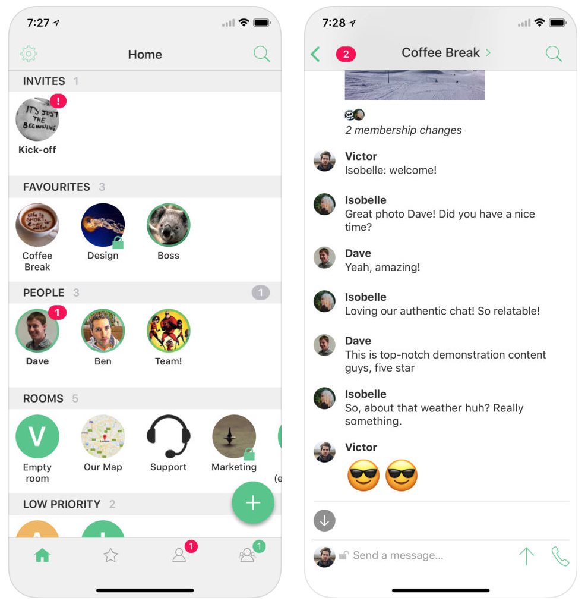

> TL;DR: I have deleted my Facebook account. Ciao.

Not much more to add. I asked for my account to be deleted. I had my reasons. Facebook provides an amazing service but it comes with a price. And the cost is your privacy. With your first log-in every photo is analyzed. Every message is read by an A.I. and even your every move outside Facebook is tracked. That all together is the new currency of the 21st century. Your behavior, opinions, your plans and desires. That's what we used to call privacy. Currently privacy is ignored. It is considered an obsolete relic and hard to exploit. It is not visible, so easily ignored. But it is so important! Over 90% of the time we act according to feelings.

Did you ever wonder why ads on web pages can be so precise? You are tracked. Did you realise that prices on Amazon are different for you and for your friends? Sales uses psychological profiles to determine margin and price per customer. Even in presidential elections. Trump used psychological profiles of USA citizens in his last campaign. Pro-Brexit party used psychological profiles to win the referendum in the UK. Read more about Cambridge Analytica if interested.

Currently the new data privacy regulation, GDPR, is being enforced and I welcome it because this field needs it. I consider it a regulation that protects your data. Nobody cared until now. The IT field is not as mature as other branches of business. There are not many regulations, so it can take advantage of its full potential. But in my opinion it took too much. It made privacy obsolete. I do not expect my letters to be opened when I send them through PPL or DHL. They do not open packages and scan them so they can sell that information to third-party partners. Do you care if they open packages? If yes, why do you not care about Facebook as well? I leave this question unanswered and let readers decide for themselves.

> My mind is clear in this matter. I have decided to leave Facebook due to its "no privacy" policy. Privacy matters!

But I do not wish to cut off my contacts. So I decided to host my own chat service where I gradually ported my family members and all important contacts.
I wanted to share the details here: "why, what and how" I did it.

## Why

My "Facexit" idea started a few months ago. I had my "last nail in the coffin" moment when I read about Cambridge Analytica.

> Propaganda works best, when you do not know its source. Facebook delivered what propagandists have always wanted, a complete blurring of the line between editorial and advertising, often delivered with the added reliability of having been “shared” by a “friend”. [1](https://www.theguardian.com/technology/2018/mar/24/facebook-week-of-shame-data-breach-observer-revelations-zuckerberg-silence)

> ... figuring out whether a particular voter was, say, a neurotic introvert, a religious extrovert, a fair-minded liberal or a fan of the occult. Those were among the psychological traits the firm claimed would provide a uniquely powerful means of designing political messages. [2](https://www.nytimes.com/2018/03/17/us/politics/cambridge-analytica-trump-campaign.html)

What I consider fundamentally broken is the monopoly:

* your identity is Facebook identity - you can have only a single account and communicate only with other Facebook accounts. If you do not like Facebook's policy, you can still leave, but you will also leave all your contacts.
* information sources - your wall is built by Facebook's algorithm. You can pick and choose your activities, follow groups, but you do not have much choice in how much "other content" - ads, propaganda, fake news - you will see. Building a personal source of information I consider one of my basic rights, to be well informed. I spend a lot of time finding proper sources. You can leave Facebook, but once again, you will lose your information sources.


> Is a choice from one option still a choice?

This is a fundamental question. Do you want to live inside a golden cage with a golden path inside or not? Do you want to embrace the truth or live in a fable? I do not expect that everybody cares, I do not expect that those who care will eventually react. But I want to give those who are willing to listen everything I have learned on my way and let them choose. To give them more options than one.

My job is to work with data, I work with algorithms that analyze you, make predictions about you and bring benefits to everybody's life. I am familiar with what it really takes to act. I can help in this case. So why shouldn't I?


## What next ...

I started this project some months ago when I was looking for a more proper alternative to Facebook. My requirements were (all must):

* simple - app has to be simple and comfortable to be used by my friends and family. My mama has to feel comfortable using it, otherwise there is no point in switching if nobody wants to message you ;-)
* messaging - be able to send simple messages, images, video
* video conferencing - support for video calls.
* ssl - support SSL everywhere and end-to-end encryption
* self hosted - data has to be stored on my servers. Otherwise there is no point in switching from Facebook. You make your communication private again by storing history outside internet vendors. I want to store it securely on my own servers.

I looked at multiple projects (ejabberd, Rocket, ...) and none could deliver all requirements until I found the Matrix project. What really struck me at first sight is that it is not a client or server but a protocol specification. And at its core it is a federated protocol. Then I realised that this is what actually solves the problem with the monopoly. Idea of federation is simple and resembles email. You may have an email account at Gmail but you can still communicate with other people in different networks, like Yahoo, AOL, Seznam, your company, because your identity is not owned by a particular network but can be shared between them. If you want to switch from your email vendor, you create another account. You do not lose your contacts. You just send them your new email address. It is simple.

Matrix is a similar concept. It also has a user address - a chat address. In my case it is:

> @peter:petercipov.com

It has a domain part (petercipov.com) and a user identifier (@peter) as you have in email. So when you want to contact someone you need their chat address. Simple.

Matrix is a federated protocol, same as email. You can use vendor hosting (e.g. matrix.org provides free chat hosting) or you can host it by yourself as I do.

Your data is stored on a homeserver and when you wish to contact somebody on a different homeserver a copy of the message is transferred. Again the same semantics as email.

You can make voice & video calls. Matrix supports WebRTC. It is possible to call a different device or even a web browser.

Matrix natively supports end-to-end encryption [1, 2]. It can be set up per room. When enabled, messages are encrypted on the client, before they are sent to the server, and that way they are visible only to recipients.

Matrix is a protocol. It provides a back-end reference implementation written in Python and there already exist multiple front-ends. Of those I like Riot.im the most: it can be installed natively on iOS and Android or used as an Electron-based desktop app or as a standalone single-page web app.

<figure>
  
  <figcaption>
    Element.IO user interface.
  </figcaption>
</figure>


## How
So I decided to host the chat service myself. My use case is purely personal. I do not want to host it for money (aka I pay the bills :)), I do not process any data (whole purpose of this project). First step was to study GDPR. I have read GDPR regulation to find out what requirements I need to fulfill. I was happy to find the following [1](https://gdpr-info.eu/art-2-gdpr/) ...

> This Regulation does not apply to the processing of personal data: ... by a natural person in the course of a purely personal or household activity;

100% compliant :)

Even more, the people behind Matrix take this regulation seriously and will provide patches to make Matrix compliant with GDPR [2](https://matrix.org/blog/2018/05/08/gdpr-compliance-in-matrix/). So for commercial purposes it will be delivered in the next few patches.

## Self Hosting

For my purposes I want to have everything simple and minimal. So the cost/value ratio would be in my favour. I bought two small 1GB RAM VPSes (virtual private servers): one for hosting the homeserver and one for hosting the STUN/TURN server used for VoIP and video calls. Domain DNS records are also required: one for the Matrix homeserver chat.petercipov.com and one for the STUN/TURN server turn.petercipov.com. The TURN server is actually pretty heavy on traffic and resources, therefore 2 VPSes.

I use the latest Debian on all instances and public/private keys for access. No passwords. All processes I use are dockerized.

* https://hub.docker.com/r/petercipov/synapse-docker/tags/ for synapse homeservers
* https://hub.docker.com/r/petercipov/coturn-docker/ for STUN/TURN server
* https://hub.docker.com/r/_/postgres/ (alpine version) as data storage

Actually you can use the official Synapse Docker image with everything wrapped inside, but I prefer to use separate processes and potentially scale and reshuffle instances myself. Nevertheless the all-in-one package is much easier to start with.

Files and images are stored directly on the file system. I have set up size monitoring, so when they reach the max limit I will back up/purge them. It is possible to use different options but for my purposes it is far from its limits.

SSL is handled by Let's Encrypt and a certbot Docker image.
```bash 
docker run \
  -v `pwd`/data/ssl:/etc/letsencrypt \
  -e distinct=true \
  -e domains="domains....." \
  -e email="email...." \
  -p 80:80 \
  -p 443:443 \
  --rm pierreprinetti/certbot:latest
```

## Conclusion

Do not be fooled by the fallacy of free services.

The whole point of privacy is ownership and control. It is an asset like your finances, houses, flats. You can hire a financial advisor to help you, you can rent a house. But you can also say no and terminate it. Before GDPR you did not have much choice with control over your privacy. You were dragged into this business even though you did not want to be. By pressing "allow access to your mobile contacts" you send all data of your friends and precreate hidden accounts for them, even for those who do not have one.

I consider GDPR a positive step towards giving us more power over privacy. If you sell it, your choice. In matters of privacy I would rather play it safe, build my own game rules and shape my life as I like it. And yes, it is a lot of extra work, but believe me it is worth it.