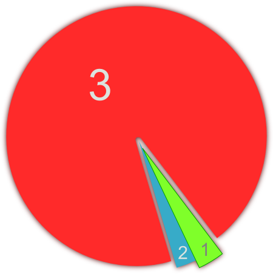

One of the many things I had to learn after graduating from college was how to get things done. I had completed successful projects before, but I spent far too much time searching for the best way to do them.

I had a habit of choosing technologies before I even knew my use cases. Programmers often like to build their own frameworks: they glue together a set of classes and are then eager to use them everywhere.

They also tend to adopt popular frameworks from the community, often lots of them. There is nothing wrong with that as long as you can clearly say what problem each one solves, what its benefits are and what slows you down. Without those answers, it is only blind religion, and sooner or later you will find yourself bending your code around the framework's limitations.

> In the end, maybe you do not need those sexy frameworks.

Another time, I had to produce a set of diagrams showing the dependencies and structure of a new protocol I was implementing. I spent so long looking for the best diagramming tool that I missed the deadline. Then I realized that I did not need one at all. A whiteboard and markers were enough to do the job fast and dirty, followed by a quick sketch in Inkscape. The task took a few hours instead of days.

> Do not try to figure out the best way because you do not see the whole picture. Just try to solve your problem.

There are three kinds of knowledge:

1. things you know
2. things you know that you don't know
3. things you don't know that you don't know

<figure>
  
  <figcaption>
    This picture displays the normal order of knowledge we possess.
  </figcaption>
</figure>

Do not try to predict the future, because we are bad at it. Focus on what is here and now, and base your decisions on real metrics. Reasoning with "it would be good to", "I think" or "I hope" is a bad practice. It can easily trap you in a corner of programming religion without creating any business value. And let's face it, business value is what generates the money we earn.
