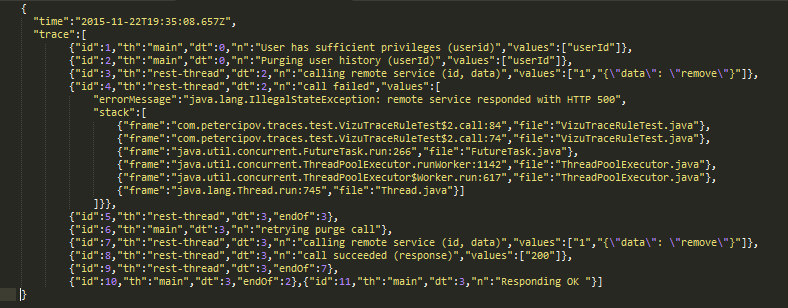
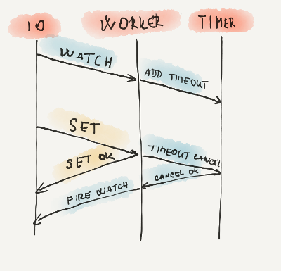
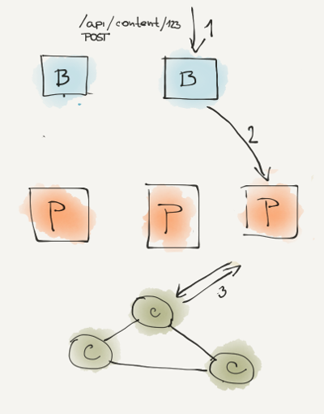

One problem you can encounter when you are making a distributed system is how to log properly. To be more precise, how to make your logs useful? In the case of a simple application shown on every tutorial blog, logs are not mentioned, or skipped. But on the other hand they are irreplaceable when you want to figure out why your system is failing. As my colleague often says:

> There is never enough logging.

There are tons of frameworks to help you with it (slf4j, log4j, …) but in my opinion they deliver only half of the solution. Systems at a bigger scale tend to have lots of logging messages. But you also have multiple machines with multiple services, all these messages are written to one giant file (or to a set of giant files) and your task is somehow to find a needle in it. It is a trivial task but with bigger and bigger log files it takes more and more time. One would save a lot of trouble if all messages that are bound together could be easily retrieved from files. And that is the essence of tracing. You somehow mark log messages together and order them by occurrence. For example you can group messages by request. All messages about database communication, your service logic messages, like ACL, custom business logic, all in a single sequence of log messages ordered by occurrence in history. It would be really handy if logs would look like this:

* API request started (path: /api/user, scope:all )
* Authorising session (session id: hgty7)
* Authorisation granted for reading
* User service is loading users
* Users loaded from database (count:452)
* Transforming to JSON
* Response sent successfully

You can trace message, parameters and exceptions. When you log them separately they have less meaning than when they are presented together. You have to process logs to actually obtain this kind of value and often it takes an enormous amount of time. Sometimes you do not even have enough information in logs to group messages reliably. It is often the case in asynchronous programming, where a request is not processed by a single thread so it does not have a single stack trace. A request is divided into a sequence of sub-tasks that are executed in order but we cannot say anything about their actual execution time, because they are planned by the system scheduler, therefore non-deterministic. You have to add additional information to the log message, some kind of id, to be sure. This way you are making custom traces.


## What is wrong with logging?
The core problem with logging is the loss of information and context. In the program you have full context. You know where you are, what are your inputs, what are the next steps. You log it to a file in some text format. Often you do not log all context information there, because you do not think it is important. Sometimes the cause of failure is a single exception from a database or a null pointer. Then logging single message is sufficient, but what about semantic errors, when a bug is hidden in a complicated flow of messages between your services? In the case of distributed systems you can encounter different kinds of failures, e.g. network floods. Then it would be handy to know what was the cause. It could be also error or some glitch in code semantics. Those kinds of errors are nearly impossible to reproduce. And it is almost too late to add more logging when they occur - your system is crumbling and you should react as soon as possible.

Your logs are stored somewhere. It may be kibana, graylog, …. Those systems provide very limited searching - no joins in searches as we are used to from SQL databases, because such searches are not scalable. We should store already aggregated data in such systems where single message input is the aggregation of messages from single request or configuration change or system start-up or tear-down. These aggregations are custom to every project even though they share some similarities.

It is handy to log everything: all input parameters (if they are reasonably small, or their sizes or their ids), all computation steps in business logic, all its results, and all its output actions (sending message or responding to request). All of this information is then serialized to text format and stored in logging system.

## Example

Let's start with a single node example: calling a remote API that purges user history. Here is the pseudo-code:

```java
public int purgeHistory(Trace trace, String userId) {  
  checkACL(trace, userId);
  purgeUserHistory(trace, userId);
  return respondOK(trace);
}
```

To purge a user's history, the user's access rights are checked, then history is purged and success response is sent back.

```java
private void purgeUserHistory(Trace trace, String userId) {  
    Event purgingEvent = trace.start("Purging user history (userId)", userId);
     try {
      callRestService(trace, 1, "{\"data\": \"remove\"}", true);
    } catch (Exception ex) {
      trace.event("retrying purge call");
      .....
    }
     purgingEvent.end();
}

private void checkACL(Trace trace, String userId) {  
    ....
    trace.event("User has sufficient privileges (userid)", userId);
}

private int respondOK(Trace trace) {  
    ....
    trace.event("Responding OK ");
    return 200;
}

private String callRestService(final Trace trace, final int id, final String data, final boolean fail) throws Exception {  
    Event callEvent = trace.start("calling remote service (id, data)", id, data);
    String code;
     try {
      if (fail) {
        code = "500";
        throw new IllegalStateException("HTTP 500"); 
      } else {
        code = "200";
      }
    trace.event("call succeeded (response)", code);
    } catch (RuntimeException ex ) {
      trace.event("call failed", ex);
      throw ex;
    } finally {
      callEvent.end();
    }
     return code;
}
```

The Trace interface is actually very simple code. It contains two methods. Start is for when you want to record some event that has a duration in history. The event is marked as finished when the end method is called. The second method is used for simpler case when you want to record an event that has occurred at single point in time.

```java
public interface Trace {  
    interface Event {
        void end();
    }

    Event start(String name, Object ... values);
    void event(String name, Object ... values);
}
```

<figure>
  
  <figcaption>
    Example of the trace.
  </figcaption>
</figure>


Every action that was made in code was recorded. Every record has a timestamp (dt - delta time, number of milliseconds from the first event) and an id that is unique in the trace and grows according to the execution order. It contains the name of the thread (th) that executed the code, the message (n), values and exception stack traces. There are some messages that refer to previous records (endOf) and they serve to note when method finished.


## Amount of data
On the other hand it produces a hell of a lot of data. It is a feature of traces that you have to mitigate and prepare your custom logic to resolve it.
In the case of high-frequency calls you can sample logging and pass NOOPTrace instead of a logging trace, and log just some percentage of them. Even such portion of data can have actual value for you. You can look for calls with high spikes. Or you can log traces only in case of exception. You would lose real-time metrics about your system but even such a trace would be more useful than a simple stack trace. It really depends on what you need from traces.

## Not a new idea at all
This idea is not new. I did not invent it. It is just handy and straightforward and I have great experience with it when I wanted to figure out "why it does not work". It is the core idea behind Google's tracing system [Dapper](https://research.google/pubs/dapper-a-large-scale-distributed-systems-tracing-infrastructure/) and [Zipkin](https://github.com/twitter/zipkin) from Twitter. I have not used Zipkin because it is focused only on the duration of methods and I actually wanted to log some portion of data. When I was researching Zipkin it missed this important feature. To the best of my knowledge it does not have this feature today. Therefore I created a simple stupid library to do what I actually wanted. On the other hand Zipkin logging via scribe and processing via collectors is very sophisticated. I do not want to compete with it. I think developers that created it have done a great job. But for my environment it was overkill.

In my case I used tracing for an application written with RxJava. The code was mostly written in a functional style. Business logic consists of sequences of timers and waiting for responses from different services. It is highly asynchronous code. Before traces, when something had failed, it was nearly impossible to reason why. There was no complete flow, just a stack trace from an executor thread. And this is the core idea, tracing is in some manner your custom stack with reasonable params, it just depends on you what is put inside and it is passed during whole execution of single request.

<figure>
  
  <figcaption>
    Example of the flow.
  </figcaption>
</figure>

In my case the service had 3 threads: one for IO, one for all event logic and a timer thread. A typical request would be watching some resource for change. The request is registered and then waits for a change. The thread is not blocked but the request is packed as a task for the timer executor with some timeout. After this timeout, the request is recovered and "no change" is returned. Otherwise, when some modification happens meanwhile, the timer is canceled and the watch returns "change occurred". I would like to somehow log this whole process: why the request was postponed, why it was recovered, which request has done it.


## What is the difference?
My point is that I have written Traces in much simpler manner than the other solutions. I do not assume anything up front. It is as explicit as possible. It does not need any annotations, any thread locals, any request contexts, any meta-programming, just no magic. This may seem in contradiction with common approach like aspect oriented programming, where you write a set of selectors and code is somehow automatically instrumented. My argument is that any automation will not bring you satisfying result. You have to decide what is important to you at line level. Any automation will bring you another level of abstraction that you have to reason about and I argue that meta programming approach will be un-maintainable because code contains just too many edge cases and in time they have tendency to spread.

Why not go with the approach of slf4j, where you have a logger factory that is statically accessible, i.e. globally? Then you do not need any extra parameter in your methods... Such an approach is optimal for standard Java code, where all methods in a program are managed by the same thread. Therefore the context is the same. But in the case of switching between multiple threads you lose your context and what is even worse it can be "reused" with other request. You may argue that you can use some kind of token, but now you end up in the same situation. You have to pass something to your methods to bind them together, why not just pass them a trace object, and then you do not need any reflection magic and code does what is actually written in it.

There is a simple rule for what to trace and what not. Trace something, that has the end in finite time, preferably in short time. Infinite algorithms would have infinite traces, and long lived tasks would have huge traces. You do not want to flood your memory with something endless, do you?

## Are traces distributed?
Simply yes and no :) You have to make them distributed.
<figure>
  
  <figcaption>
    Distributed trace.
  </figcaption>
</figure>

Let's take a simple example where you have balancer nodes (B), processing nodes (P) and Cassandra nodes (C). When a request (1) arrives to this infrastructure it is routed by internal balancer logic and passed (2) to a processing node. Here it is processed again, a call to Cassandra is executed (3) and then the response is returned back to the client. To trace these calls you have to pass some kind of global trace id through layers, so on each node you log a separate trace marked with this global trace id, so that afterwards you can just load all traces with the same global trace id. You generate this global trace id at the entry and then just pass it to subsequent layers. It is just the same idea as passing trace objects via your code.

## Is it a "new blue"?
Traces are not something new, it is just a different approach to logging. The question is: do you need them? When you have a distributed system with a complicated set of messages that are sent between services I recommend you to consider them. You would have to figure out what amount of data you can handle and modify your code. It is some amount of work, but again any automation and general solution with aspects may not bring satisfaction. Even I am sometimes not sure from the beginning what to trace but when code starts to behave strangely I add more traces. Now I am used to using them everywhere but it may not be your case. As always, there is no silver bullet. It is just a good aid when you are stuck with the same sets of problems as I have.

You can find sources [here](https://github.com/petercipov/traces)